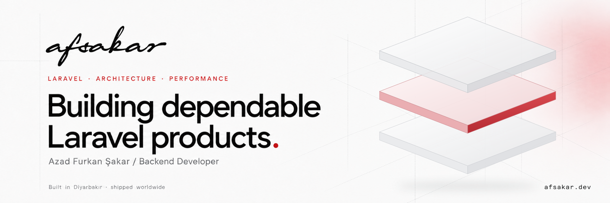

  <a href="https://afsakar.dev/">Portfolio</a> ·
  <a href="https://afsakar.dev/packages">Packages</a> ·
  <a href="https://afsakar.dev/blog">Writing</a> ·
  <a href="https://www.linkedin.com/in/afsakar">LinkedIn</a> ·
  <a href="mailto:me@afsakar.dev">Get in touch</a>

## Hi, I'm Azad Furkan Şakar

I'm a backend developer based in Diyarbakır, Türkiye, working with **Laravel, FilamentPHP, and modern PHP**. I build maintainable applications, developer tools, and packages that solve practical product problems.

My background is in civil engineering. Today, I bring that same attention to solid foundations, clear constraints, and dependable outcomes to software.

- **At work:** Backend Developer at Penta Software.
- **On GitHub:** Laravel packages, Filament plugins, and open-source tooling.
- **What I care about:** Thoughtful architecture, performance, and a polished user experience.

## Selected work

| Package | What it does |
| :--- | :--- |
| [Filament Panel Kit](https://afsakar.dev/packages/filament-panel-kit) | Themes, floating layouts, branded authentication screens, and runtime appearance switching for Filament panels. |
| [SatisHub](https://afsakar.dev/packages/satishub) | Sell private Composer packages with license-based access control. |
| [OTP Login](https://afsakar.dev/packages/filament-otp-login) | OTP authentication for Filament panels, including passwordless login. |
| [Leaflet Map Picker](https://afsakar.dev/packages/filament-leaflet-map-picker) | An interactive map field for selecting and storing geographical coordinates. |

[Explore all packages →](https://afsakar.dev/packages)

## My working set

| Area | Technologies |
| :--- | :--- |
| Backend & panels | PHP · Laravel · FilamentPHP · Livewire |
| Frontend | Vue.js · Nuxt · TypeScript · Alpine.js · Tailwind CSS |
| Data & tooling | MySQL · SQLite · Pest · Laravel Herd · GitHub Actions |

## Notes from the work

I write about Laravel, Filament, package design, and the decisions behind maintainable products. I also explore AI assistants and tools that improve everyday development.

[Read my writing →](https://afsakar.dev/blog)

## Let's build something dependable

Have a Laravel product problem or a package idea worth shipping? [Get in touch](mailto:me@afsakar.dev) or connect on [LinkedIn](https://www.linkedin.com/in/afsakar).

If my open-source packages help your work, you can [support their development on GitHub Sponsors](https://github.com/sponsors/afsakar).

---

Solid foundations, solid code. Built in Diyarbakır · shipped worldwide.

